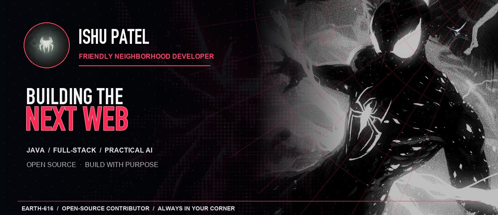
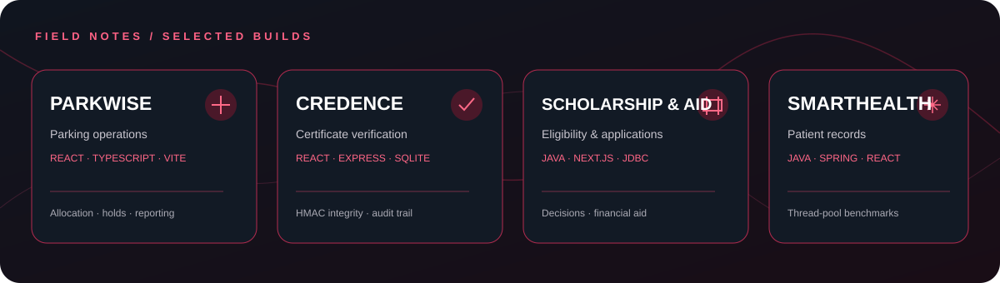
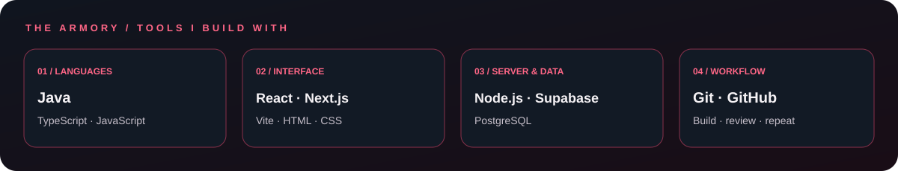
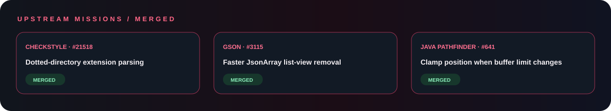

<!-- Spider-Man visual direction: ink, scarlet, magenta glitch, and comic halftone. -->

  

  <a href="#signal">◉ SIGNAL</a> &nbsp;·&nbsp;
  <a href="#projects">◈ PROJECTS</a> &nbsp;·&nbsp;
  <a href="#open-source">⌁ OPEN SOURCE</a> &nbsp;·&nbsp;
  <a href="#contact">↗ CONTACT</a>

I’m **Ishu Patel**, a Computer Science & Engineering student who likes turning tricky problems into software people can use. I work across **Java, full-stack development, and practical AI**—learning by building, measuring, and contributing back.

> *With great code comes great responsibility.*

<picture><source media="(prefers-reduced-motion: reduce)" srcset="assets/spider/signal-poster.png" /></picture>

## SPIDER-SENSE 

| Signal | Current focus |
| --- | --- |
| **Learning** | Java · data structures · algorithmic problem solving |
| **Building** | Full-stack tools with clear, practical workflows |
| **Exploring** | AI agents · LLM-assisted apps · explainable decision systems |
| **Contributing** | Open-source Java projects |

## PROJECTS 

| Project | What it does | Source / demo |
| --- | --- | --- |
| **Parkwise** | Vehicle allocation, visitor holds, maintenance controls, and reporting. | [Repository](https://github.com/ishu7w/parkwise) · [Live preview](https://parkwise-beta.vercel.app/) |
| **Credence** | Certificate issuance and verification with HMAC integrity and audit history. | [Repository](https://github.com/ishu7w/digital-certification-system) · [Read-only preview](https://digital-certification-system-mu.vercel.app/) |
| **Scholarship & Aid** | Eligibility, applications, institutional decisions, and financial aid. | [Repository](https://github.com/ishu7w/scholarship-financial-aid-system) · [Live preview](https://scholarship-financial-aid-system.vercel.app/) |
| **SmartHealth** | Educational patient records and Java thread-pool benchmarks. | [Repository](https://github.com/ishu7w/SmartHealth) |

Project notes

- Parkwise is a single-device prototype.
- Credence’s hosted preview is read-only; its local version supports issuance and revocation.
- SmartHealth is an educational prototype; run its Java backend locally for the complete experience.

## SUIT TECH

| Layer | Tools |
| --- | --- |
| **Languages** | Java · TypeScript · JavaScript |
| **Interface** | React · Next.js · Vite · HTML · CSS |
| **Server & data** | Node.js · Supabase · PostgreSQL |
| **Workflow** | Git · GitHub |

I apply Java beyond practice problems: implementing scholarship rules and persistent workflows in [Scholarship & Aid](https://github.com/ishu7w/scholarship-financial-aid-system), and measuring sequential versus thread-pool processing in [SmartHealth](https://github.com/ishu7w/SmartHealth). I care about the algorithm, the edge cases, and the tradeoffs.

## OPEN SOURCE 

Focused fixes are small threads in a much bigger web. Here are a few merged contributions:

- **[Checkstyle #21518](https://github.com/checkstyle/checkstyle/pull/21518)** — Correct file-extension parsing for dotted directories. MERGED
- **[Gson #3115](https://github.com/google/gson/pull/3115)** — Avoid quadratic `removeIf` behavior in JsonArray list views. MERGED
- **[Java Pathfinder #641](https://github.com/javapathfinder/jpf-core/pull/641)** — Fix position clamping when a buffer limit changes. MERGED

Profile metrics · updated 2026-10-25

- **26** public repositories, including forks.
- **3** stars across public, non-fork repositories.
- **4** followers.
- **33** merged public pull requests outside my own repositories.
- Language proportions measure code bytes across public non-fork repositories; they are not proficiency ratings.
- [Snapshot and language totals](data/stats.json) · [Contribution history](https://github.com/ishu7w?tab=overview)

## CONTACT 

Interested in practical AI, open-source Java, or a good hackathon problem? Send me a signal.

  <a href="mailto:ishu7w@gmail.com"><strong>EMAIL ISHU</strong></a>
  &nbsp; ◇ &nbsp;
  <a href="https://github.com/ishu7w"><strong>EXPLORE ALL REPOSITORIES</strong></a>

Keep building. Keep helping. Your friendly neighborhood developer.

