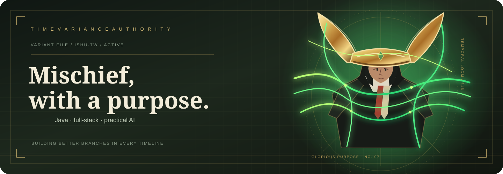
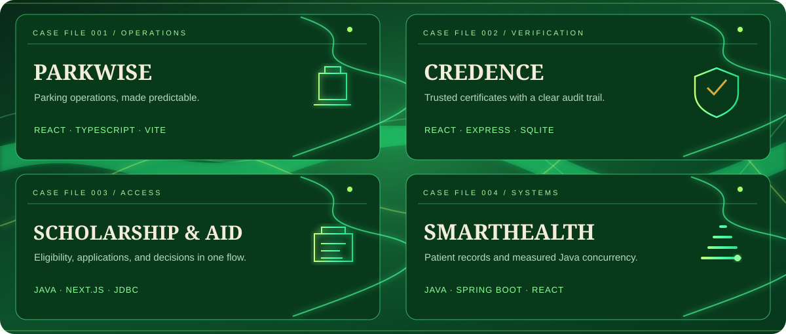

<!-- TVA casefile aesthetic: emerald chronal strands, brass details, original Loki-inspired helmet silhouette. -->

  

  <a href="#case-files">⌁ CASE FILES</a> &nbsp;·&nbsp;
  <a href="#open-source">⌁ OPEN SOURCE</a> &nbsp;·&nbsp;
  <a href="#connect">⌁ CONNECT</a>

I’m **Ishu Patel**, a Computer Science & Engineering student who likes turning difficult problems into useful software. I work across Java, full-stack development, and applied AI—learning by building, measuring, and contributing back.

> **Variant directive:** question the obvious path; ship something that helps.

## ⏱ CURRENT DIRECTIVE

| TVA status | Active branch |
| --- | --- |
| **Learning** | Java · data structures · algorithmic problem solving |
| **Building** | Full-stack tools with clear, practical workflows |
| **Exploring** | AI agents · LLM-assisted applications · explainable decision systems |
| **Contributing** | Open-source Java projects |

## 🗂 CASE FILES 

  

| Project record | Repository | Preview |
| --- | --- | --- |
| **Parkwise** — vehicle allocation, visitor holds, maintenance controls, and reporting. | [Open file](https://github.com/ishu7w/parkwise) | [Live preview](https://parkwise-beta.vercel.app/) |
| **Credence** — certificate issuance and verification with HMAC integrity and audit history. | [Open file](https://github.com/ishu7w/digital-certification-system) | [Read-only preview](https://digital-certification-system-mu.vercel.app/) |
| **Scholarship & Aid** — eligibility, applications, institutional decisions, and financial aid. | [Open file](https://github.com/ishu7w/scholarship-financial-aid-system) | [Live preview](https://scholarship-financial-aid-system.vercel.app/) |
| **SmartHealth** — educational patient records and Java thread-pool benchmarks. | [Open file](https://github.com/ishu7w/SmartHealth) | Local backend |

Field notes

- Parkwise is a single-device prototype.
- Credence’s hosted preview is read-only; its local version supports issuance and revocation.
- SmartHealth is an educational prototype; run its Java backend locally for the complete experience.

## 🧰 SYSTEMS & TOOLS

| Domain | Instruments |
| --- | --- |
| **Languages** | Java · TypeScript · JavaScript |
| **Interface** | React · Next.js · Vite · HTML · CSS |
| **Server & data** | Node.js · Supabase · PostgreSQL |
| **Workflow** | Git · GitHub |

### Java, DSA & real code

I apply Java beyond practice problems: implementing scholarship rules and persistent workflows in [Scholarship & Aid](https://github.com/ishu7w/scholarship-financial-aid-system), and measuring sequential versus thread-pool processing in [SmartHealth](https://github.com/ishu7w/SmartHealth). I care about the algorithm, the edge cases, and the tradeoffs.

## 🟢 OPEN SOURCE 

Small, focused fixes can prevent surprising behavior across many timelines.

- **[Checkstyle #21518](https://github.com/checkstyle/checkstyle/pull/21518)** — Correct file-extension parsing for dotted directories. MERGED
- **[Gson #3115](https://github.com/google/gson/pull/3115)** — Avoid quadratic `removeIf` behavior in JsonArray list views. MERGED
- **[Java Pathfinder #641](https://github.com/javapathfinder/jpf-core/pull/641)** — Fix position clamping when a buffer limit changes. MERGED

Timeline metrics · updated 2026-10-25

- **26** public repositories, including forks.
- **3** stars across public, non-fork repositories.
- **3** followers.
- **32** merged public pull requests outside my own repositories.
- Language proportions measure code bytes across public non-fork repositories; they are not proficiency ratings.
- [Snapshot and language totals](data/stats.json) · [Contribution history](https://github.com/ishu7w?tab=overview)

## ✉️ CONTACT 

Interested in practical AI, open-source Java, or a good hackathon problem? Send me a transmission.

  <a href="mailto:ishu7w@gmail.com"><strong>OPEN COMM CHANNEL</strong></a>
  &nbsp; ◇ &nbsp;
  <a href="https://github.com/ishu7w"><strong>VIEW ALL REPOSITORIES</strong></a>

Understand the system. Find the branch. Make it better.

