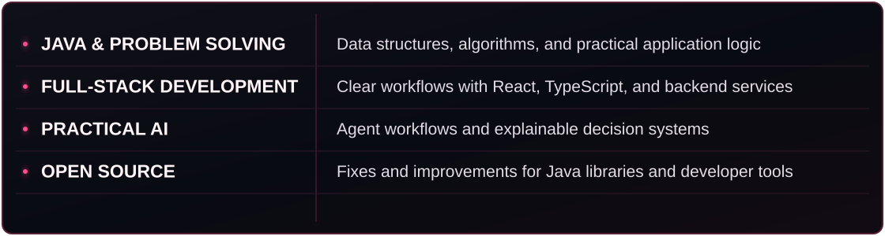
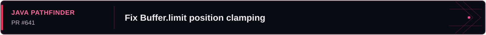

<!-- Spider-Man identity: ink, scarlet web lines, white emblem, and magenta signal art. -->

  <picture>
    <source media="(prefers-reduced-motion: reduce)" srcset="assets/spider/hero.jpg" />
    
  </picture>

  <a href="#github">GITHUB</a> &nbsp;·&nbsp;
  <a href="#projects">PROJECTS</a> &nbsp;·&nbsp;
  <a href="#open-source">OPEN SOURCE</a> &nbsp;·&nbsp;
  <a href="#contact">CONTACT</a>

I’m **Ishu Patel**, a Computer Science & Engineering student working across **Java, full-stack software, and practical AI**. I build projects, practice data structures and algorithms, and contribute fixes to open-source Java tools.

<picture><source media="(prefers-reduced-motion: reduce)" srcset="assets/spider/signal-poster.png" /></picture>

## GITHUB ACTIVITY 

<picture><source media="(prefers-reduced-motion: reduce)" srcset="assets/spider/github-account-static.svg" /></picture>

The language bar reflects **code bytes**, not proficiency. The repository count includes forks; the language totals and stars exclude them. [View the profile and contribution history](https://github.com/ishu7w?tab=overview) · [Snapshot data](data/stats.json)

## CURRENT FOCUS

## PROJECTS 

<a href="https://github.com/ishu7w/parkwise"><picture><source media="(prefers-reduced-motion: reduce)" srcset="assets/spider/project-parkwise-static.png" /></picture></a>

Parking allocation, visitor holds, maintenance controls, and reporting. **Stack:** React · TypeScript · Vite · [Live preview](https://parkwise-beta.vercel.app/)

<a href="https://github.com/ishu7w/digital-certification-system"><picture><source media="(prefers-reduced-motion: reduce)" srcset="assets/spider/project-credence-static.png" /></picture></a>

Certificate issuance and verification with HMAC integrity and audit history. **Stack:** React · Express · SQLite · [Read-only preview](https://digital-certification-system-mu.vercel.app/)

<a href="https://github.com/ishu7w/scholarship-financial-aid-system"><picture><source media="(prefers-reduced-motion: reduce)" srcset="assets/spider/project-scholarship-aid-static.png" /></picture></a>

Eligibility, applications, institutional decisions, and financial aid. **Stack:** Java · Next.js · JDBC · [Live preview](https://scholarship-financial-aid-system.vercel.app/)

<a href="https://github.com/ishu7w/SmartHealth"><picture><source media="(prefers-reduced-motion: reduce)" srcset="assets/spider/project-smarthealth-static.png" /></picture></a>

Educational patient records and Java thread-pool benchmarks. **Stack:** Java · Spring Boot · React

Project notes

- Parkwise is a single-device prototype.
- Credence’s hosted preview is read-only; its local version supports issuance and revocation.
- SmartHealth is an educational prototype; run its Java backend locally for the complete experience.

## TECH STACK

<strong>LANGUAGES</strong>

<strong>FRONTEND</strong>

<strong>BACKEND &amp; DATA</strong>

<strong>WORKFLOW</strong>

I use Java in both [Scholarship & Aid](https://github.com/ishu7w/scholarship-financial-aid-system), which implements scholarship rules and persistent workflows, and [SmartHealth](https://github.com/ishu7w/SmartHealth), where I measure sequential and thread-pool processing.

## OPEN SOURCE 

<picture><source media="(prefers-reduced-motion: reduce)" srcset="assets/spider/open-source-static.png" /></picture>

Selected upstream work · [Explore all 33 merged contributions](https://github.com/pulls?q=is%3Apr+is%3Amerged+author%3Aishu7w+-user%3Aishu7w)

Account metrics · updated 2026-10-25

- **26** public repositories, including forks.
- **14** original public repositories.
- **3** stars across public, non-fork repositories.
- **4** followers.
- **33** merged public pull requests outside my own repositories.
- Language proportions measure code bytes across public non-fork repositories; they are not proficiency ratings.
- [Snapshot and language totals](data/stats.json) · [Contribution history](https://github.com/ishu7w?tab=overview)

## CONTACT 

Open to conversations about practical AI, open-source Java, and collaborative projects.

  <a href="mailto:ishu7w@gmail.com"><strong>EMAIL ISHU</strong></a>
  &nbsp;·&nbsp;
  <a href="https://github.com/ishu7w"><strong>GITHUB PROFILE</strong></a>

