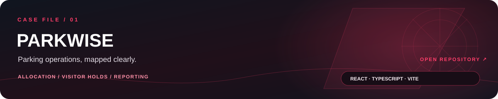
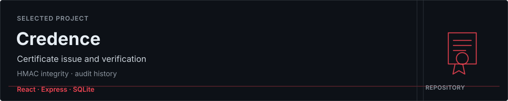
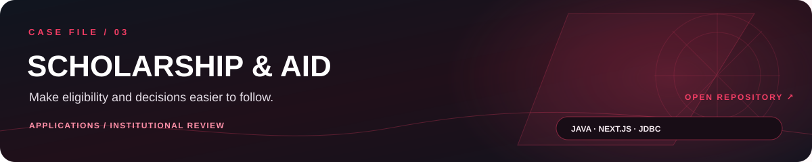
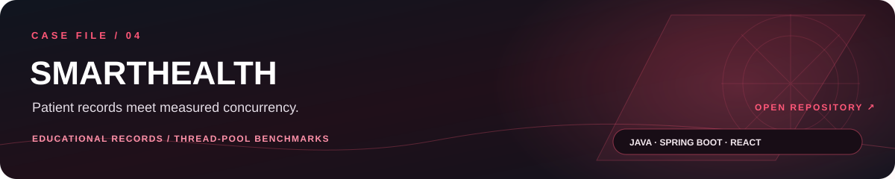

<!-- Spider-Man identity, using GitHub's dark palette and verified profile details. -->

  <picture>
    <source media="(prefers-reduced-motion: reduce)" srcset="assets/spider/hero.jpg" />
    
  </picture>

  <a href="#github">GITHUB</a> &nbsp;·&nbsp;
  <a href="#projects">PROJECTS</a> &nbsp;·&nbsp;
  <a href="#open-source">OPEN SOURCE</a> &nbsp;·&nbsp;
  <a href="#contact">CONTACT</a>

I’m **Ishu Patel**, a Computer Science & Engineering student working across **Java, full-stack software, and practical AI**. I build projects, practice data structures and algorithms, and contribute fixes to open-source Java tools.

## GITHUB ACTIVITY 

<picture><source media="(prefers-reduced-motion: reduce)" srcset="assets/spider/github-account-static.svg" /></picture>

The language bar reflects **code bytes**, not proficiency. The repository count includes forks; the language totals and stars exclude them. [View the profile and contribution history](https://github.com/ishu7w?tab=overview) · [Snapshot data](data/stats.json)

## CURRENT FOCUS

| Area | Work in progress |
| --- | --- |
| **Java & problem solving** | Data structures, algorithms, and practical application logic |
| **Full-stack development** | Building clear workflows with React, TypeScript, and backend services |
| **Practical AI** | Exploring agent workflows and explainable decision systems |
| **Open source** | Fixes and improvements for Java libraries and developer tools |

## PROJECTS 

Parking allocation, visitor holds, maintenance controls, and reporting. **Stack:** React · TypeScript · Vite · [Live preview](https://parkwise-beta.vercel.app/)

Certificate issuance and verification with HMAC integrity and audit history. **Stack:** React · Express · SQLite · [Read-only preview](https://digital-certification-system-mu.vercel.app/)

Eligibility, applications, institutional decisions, and financial aid. **Stack:** Java · Next.js · JDBC · [Live preview](https://scholarship-financial-aid-system.vercel.app/)

Educational patient records and Java thread-pool benchmarks. **Stack:** Java · Spring Boot · React

Project notes

- Parkwise is a single-device prototype.
- Credence’s hosted preview is read-only; its local version supports issuance and revocation.
- SmartHealth is an educational prototype; run its Java backend locally for the complete experience.

## TECH STACK

| Area | Tools |
| --- | --- |
| **Languages** | Java · TypeScript · JavaScript |
| **Interface** | React · Next.js · Vite · HTML · CSS |
| **Server & data** | Node.js · Supabase · PostgreSQL |
| **Workflow** | Git · GitHub |

I use Java in both [Scholarship & Aid](https://github.com/ishu7w/scholarship-financial-aid-system), which implements scholarship rules and persistent workflows, and [SmartHealth](https://github.com/ishu7w/SmartHealth), where I measure sequential and thread-pool processing.

## OPEN SOURCE 

Three merged upstream pull requests:

- **[Checkstyle #21518](https://github.com/checkstyle/checkstyle/pull/21518)** — Correct file-extension parsing for dotted directories.
- **[Gson #3115](https://github.com/google/gson/pull/3115)** — Avoid quadratic `removeIf` behavior in JsonArray list views.
- **[Java Pathfinder #641](https://github.com/javapathfinder/jpf-core/pull/641)** — Fix position clamping when a buffer limit changes.

Account metrics · updated 2026-10-25

- **26** public repositories, including forks.
- **14** original public repositories.
- **3** stars across public, non-fork repositories.
- **4** followers.
- **33** merged public pull requests outside my own repositories.
- Language proportions measure code bytes across public non-fork repositories; they are not proficiency ratings.
- [Snapshot and language totals](data/stats.json) · [Contribution history](https://github.com/ishu7w?tab=overview)

## CONTACT 

Open to conversations about practical AI, open-source Java, and collaborative projects.

  <a href="mailto:ishu7w@gmail.com"><strong>EMAIL ISHU</strong></a>
  &nbsp;·&nbsp;
  <a href="https://github.com/ishu7w"><strong>GITHUB PROFILE</strong></a>

